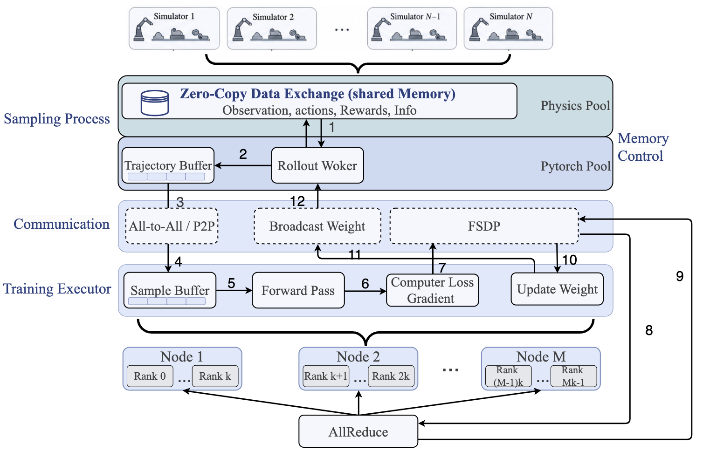
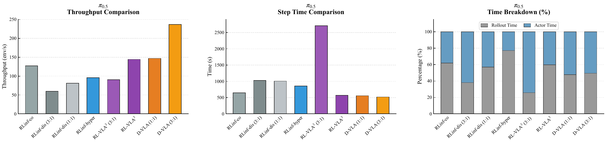
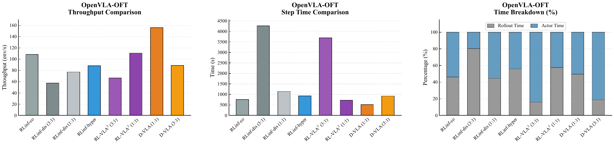

# D-VLA

Official implementation of the NeurIPS 2026 paper:

**D-VLA: A High-Concurrency Distributed Asynchronous Reinforcement Learning Framework for Vision-Language-Action Models**


[Overview](#overview) · [Method](#method) · [Results](#results) · [Citation](#citation) [Code](https://github.com/jd-opensource/ERA/)

## Overview

D-VLA is a distributed asynchronous reinforcement learning framework for post-training Vision-Language-Action (VLA) models through online environment interaction. It addresses resource contention between physics simulation and model computation, communication stalls, and GPU memory pressure in high-concurrency embodied learning.

D-VLA separates trajectory transfer from weight synchronization, overlaps rollout and training through a four-thread **Swimlane** pipeline, and combines **dual-pool GPU memory management** with **in-process zero-copy observation access**. Experiments cover **π<sub>0.5</sub> (3B)** and **OpenVLA-OFT (7B)** on **ManiSkill** and **LIBERO**, with both **GRPO** and **PPO** training paths.

Key results:

- **Higher throughput on 16 GPUs:** 376.00 env/s for π<sub>0.5</sub> and 250.90 env/s for OpenVLA-OFT, improving over RLinf-co by **61.91%** and **187.73%**, respectively, at each model's best reported D-VLA resource split.
- **Multi-node weak scaling:** **5,352.70 env/s** and **86.70% scaling efficiency** at 256 GPUs, relative to an 8-GPU reference.
- **Higher simulation capacity:** dual-pool memory partitioning frees approximately **5.8 GiB** and increases maximum stable concurrency from **4,352 to 4,608 environments** in the capacity experiment.
- **Lower observation-access latency:** **7.26–7.51 μs** for the in-process zero-copy path, approximately **1.1%** of the measured NCCL transfer-path latency.
- **Learning gains with both objectives:** compared with RLinf-co, GRPO improves throughput by **33.22%** and training-trajectory success by **19.85 percentage points**; PPO improves them by **4.68%** and **12.68 percentage points**.

## Method



### Plane Decoupling

D-VLA uses separate communication paths for trajectory data and policy weights:

| Plane | Backend | Role |
| --- | --- | --- |
| Training Data Plane | NCCL | Transfers bulk rollout trajectories to actor workers; supports point-to-point or batch distribution according to the configured resource split. |
| Weight Control Plane | CPU-side Gloo | Distributes updated policy weights through contiguous host buffers in a background thread. |

The host-side weight channel can progress independently of the CUDA synchronization path used by PhysX reset. Staging and applying weights still incur data-movement costs. In the tested scheduling configuration, Gloo completes training while the NCCL weight-sync variant times out before completing its first step.

### Four-Thread Swimlane Pipeline

Four execution threads overlap the major stages of training:

1. **Sampling:** steps simulation environments, runs policy inference, and accumulates rollout trajectories.
2. **Weight reception:** receives updated policy weights in the background.
3. **Training:** consumes buffered trajectories and performs policy optimization.
4. **Weight distribution:** sends updated weights back to rollout workers.

Lightweight semaphores coordinate the threads, while an actor-side host-memory queue buffers differences between rollout production and training consumption. Completed successful episodes are reset and replenished without waiting for the slowest trajectory. The achievable overlap depends on the balance between rollout and actor workloads.

### Memory Management and Observation Locality

D-VLA partitions GPU memory into a **Model Computation Pool**, managed by PyTorch's caching allocator, and an **Environment Auxiliary Pool** for physics-engine temporary objects. This reduces competition between cached model allocations and simulator buffers, increasing the measured concurrency ceiling.

When simulation and inference share a process, inference accesses observations directly through the **zero-copy path**, avoiding transfer of the observation payload between separate components.

### Placement and Multi-Node Execution

D-VLA supports **co-located, separated, and hybrid placements**. In the evaluated hybrid deployment, environment simulation and rollout inference share a GPU group, while actor training uses a separate group. Placement and rollout-side:actor GPU ratios are configured per run according to the workload and hardware topology.

For multi-node execution, D-VLA replicates the local sampling–inference topology, keeping high-frequency environment–rollout traffic within each node. Actor workers synchronize the model through **Fully Sharded Data Parallel (FSDP)**, and updated weights return through background Gloo communication.

Environment integration uses queues carrying observations, actions, and rewards. Adapting an additional physics engine requires an environment data adapter; the paper evaluates single-agent tasks in ManiSkill and LIBERO.

## Results

 Experiments: multi-node runs use **InfiniBand**. Throughput is measured in **env/s**, meaning environment state transitions per second. System, algorithm, and scaling comparisons use their respective configurations.

### ManiSkill: 16-GPU Throughput

The system comparison uses GRPO, the reported 128-environment/GPU setting, four rollout epochs, and a global training batch size of 2,048. Values are **mean ± standard deviation across six seeds**. Ratios denote the nominal **rollout-side:actor GPU allocation**; internal component placements differ across frameworks.

| Framework | π<sub>0.5</sub> throughput (env/s) ↑ | OpenVLA-OFT throughput (env/s) ↑ |
| --- | ---: | ---: |
| RLinf-co | 232.23 ± 2.32 | 87.20 ± 0.87 |
| RLinf-dis (1:1) | 150.58 ± 1.51 | 107.23 ± 1.07 |
| RLinf-dis (3:1) | 175.29 ± 1.75 | 99.33 ± 4.99 |
| RLinf-hyper | 171.74 ± 1.72 | 77.23 ± 2.77 |
| RL-VLA³ (1:1) | 244.61 ± 2.45 | 170.48 ± 2.70 |
| RL-VLA³ (3:1) | 250.77 ± 2.51 | 152.98 ± 3.53 |
| D-VLA (1:1) | 336.04 ± 3.36 | **250.90 ± 2.51** |
| D-VLA (3:1) | **376.00 ± 3.76** | 154.23 ± 1.54 |

The best D-VLA split is **3:1 for π<sub>0.5</sub>** and **1:1 for OpenVLA-OFT**, reflecting their different rollout and training workloads. At those splits, D-VLA improves throughput over the corresponding RL-VLA³ rows by **49.94%** and **47.17%**, respectively.

### ManiSkill: 8-GPU Throughput and Timing



*π<sub>0.5</sub> on eight H200 GPUs. Throughput is in env/s; step, rollout, and actor times are seconds per training iteration.*



*OpenVLA-OFT on eight H200 GPUs, with the same unit conventions. Resource ratios denote rollout-side:actor GPU allocation.*

In the 8-GPU π<sub>0.5</sub> comparison, D-VLA reaches **237.0 env/s** at 3:1, compared with **127.24 env/s** for RLinf-co. The paper also reports an end-to-end iteration time of **566.41 s** for D-VLA versus **1,006.8 s** for RLinf-dis, a **43.74% reduction**. For OpenVLA-OFT, D-VLA reaches **156.0 env/s**, improving over RLinf-co and RL-VLA³ by **44.12%** and **40.69%**, respectively.

### LIBERO: CPU-Intensive Workloads

Across the reported 8-GPU LIBERO configurations, D-VLA achieves the highest throughput in every row, with improvements over RLinf ranging from **20.83% to 76.99%**. The table below shows the highest-throughput D-VLA configuration for each model and its matched baselines. Values are **mean ± sample standard deviation across six seeds**.

| Model | Rollout:actor GPUs | Total environments | RLinf (env/s) | RL-VLA³ (env/s) | D-VLA (env/s) |
| --- | ---: | ---: | ---: | ---: | ---: |
| π<sub>0.5</sub> | 6:2 | 192 | 168.63 ± 0.78 | 227.05 ± 2.10 | **298.45 ± 3.41** |
| OpenVLA-OFT | 4:4 | 128 | 181.22 ± 0.62 | 214.11 ± 0.50 | **254.30 ± 0.12** |

On LIBERO, the gains come from overlapping rollout with actor updates and reducing scheduling and serialization stalls in the CPU-intensive execution path.

### Multi-Node Weak Scaling: 8 → 256 GPUs

This separate study uses **π<sub>0.5</sub>, ManiSkill, GRPO, a 3:1 split**, and the reported **192-environment/GPU budget**. For G total GPUs, the global batch size is **192 × G**, with a mini-batch size of **192**.

| GPUs | Global batch | D-VLA (env/s) | RL-VLA³ (env/s) | RLinf (env/s) |
| --- | ---: | ---: | ---: | ---: |
| 8 | 1,536 | **192.94** | 130.64 | 94.03 |
| 16 | 3,072 | **376.23** | 248.22 | 174.07 |
| 32 | 6,144 | **714.84** | 446.80 | 296.34 |
| 64 | 12,288 | **1,406.65** | 854.27 | 550.20 |
| 128 | 24,576 | **2,720.29** | 1,608.27 | 1,002.92 |
| 256 | 49,152 | **5,352.70** | 3,058.47 | 1,866.03 |

Scaling efficiency is calculated against each framework's own 8-GPU throughput: **Efficiency(G) = Throughput(G) / [Throughput(8) × (G / 8)] × 100%**.

At 256 GPUs, the reported efficiencies are **86.70% for D-VLA**, **73.16% for RL-VLA³**, and **62.02% for RLinf**.

### Mechanism-Level Ablations

| Mechanism | Comparison | Reported result |
| --- | --- | --- |
| Weight synchronization | Gloo vs. NCCL under the tested reset/synchronization schedule | Gloo completes training; NCCL times out before completing the first step. |
| Dual-pool memory partitioning | Partitioning ON vs. OFF | Free device memory increases from 19,588 to 25,486 MiB; maximum stable concurrency rises from 4,352 to 4,608 environments. |
| In-process observation access | Zero-copy vs. the measured NCCL observation path | 7.26–7.51 μs vs. 691–706 μs for batches of 32–128 observations. |

These experiments isolate synchronization stability, memory capacity, and observation-access latency under their respective measurement configurations.

### GRPO and PPO: Throughput and Training Success

The algorithm comparison uses **π<sub>0.5</sub> on ManiSkill PutOnPlateInScene25Main-v3**, **384 training environments**, a **global batch size of 2,048**, and **300 training iterations**. Runs start from the same SFT checkpoint, with shared model and optimization settings aligned across frameworks.

| Algorithm | Framework | Throughput (env/s) ↑ | Training-trajectory success (%) ↑ |
| --- | --- | ---: | ---: |
| GRPO | RLinf-co | 230.3 ± 2.1 | 58.84 ± 5.04 |
| GRPO | RL-VLA³ | 264.6 ± 2.9 | 63.77 ± 3.58 |
| GRPO | **D-VLA** | **306.8 ± 3.7** | **78.69 ± 2.12** |
| PPO | RLinf-co | 175.4 ± 1.7 | 73.66 ± 1.68 |
| PPO | RL-VLA³ | 179.5 ± 1.3 | 80.00 ± 1.59 |
| PPO | **D-VLA** | **183.6 ± 0.8** | **86.34 ± 1.50** |

Throughput is reported as mean ± standard deviation. **Success measures training-trajectory success**, summarized as mean ± standard deviation over the final 50 training steps in the converged segment near steps 250–300. Independent evaluation is disabled during these training runs.

Compared with RLinf-co, D-VLA improves throughput and training success by **33.22% / 19.85 percentage points with GRPO** and **4.68% / 12.68 percentage points with PPO**.

## Citation

If you find D-VLA useful in your research, please cite our paper:

```bibtex
@inproceedings{guo2026dvla,
  title     = {{D-VLA}: A High-Concurrency Distributed Asynchronous Reinforcement Learning Framework for Vision-Language-Action Models},
  author    = {Guo, Yucheng and Guo, Yongjian and Guan, Zhong and Huang, Wen and Yue, Haodong and Di, Shuai and Wu, Xiong Jun and Gong, Yicheng},
  booktitle = {Advances in Neural Information Processing Systems},
  year      = {2026},
  url       = {https://github.com/Aurora24Thu/D-VLA}
}
```
